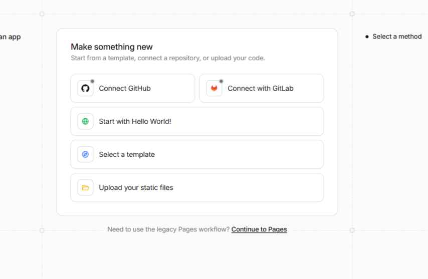
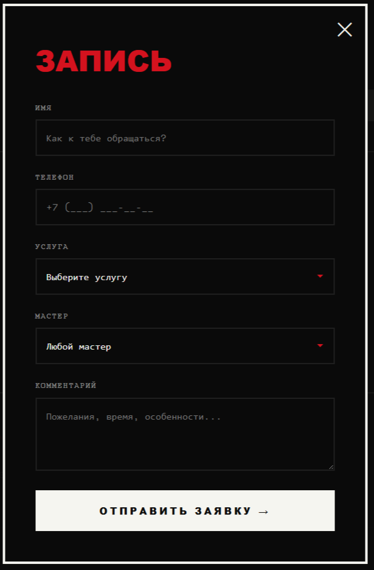
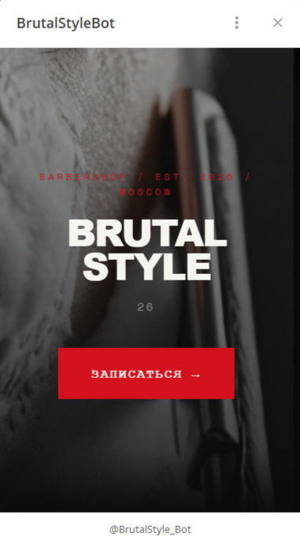
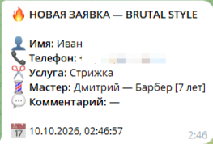

# 💈 BRUTAL STYLE — Барбершоп с Telegram-интеграцией

> Современный лендинг барбершопа с брутальным дизайном, автоматической отправкой заявок в Telegram и нативным Mini App внутри мессенджера.

**Live Demo:** https://alphastatex.github.io/barbershop/

---

## 📸 Скриншоты

|          Главный экран          |          Форма бронирования          |
| :-----------------------------: | :----------------------------------: |
|  |  |

|      Mini App в Telegram       |          Заявка в Telegram           |
| :----------------------------: | :----------------------------------: |
|  |  |

## 🏗 Архитектура и Безопасность

Проект использует связку **GitHub Pages (Frontend)** + **Cloudflare Workers (Backend)**.

### 🛡️ Почему это безопасно? (Zero Trust)

Ранее проект использовал открытый прокси, что позволяло любому желающему спамить сообщениями от имени бота. Теперь архитектура построена по принципу **Zero Trust**:

1. **Никаких секретов на клиенте**: Токен бота (`BOT_TOKEN`) и ID чата (`ADMIN_CHAT_ID`) хранятся в зашифрованных секретах Cloudflare (`wrangler secret`). В коде фронтенда их нет.
2. **Валидация `initData` (с умным фоллбэком)**: Cloudflare Worker проверяет криптографическую подпись (HMAC-SHA256), которую генерирует Telegram.
   - Если заявка пришла из Telegram — проверяется подпись и извлекается `@username`.
   - Если заявка пришла из обычного браузера (без Telegram) — она **не блокируется**, а помечается как `🌐 Из браузера (без Telegram)`.
   - Если заявка пришла из Telegram Desktop (где прокси может исказить данные) — она **не блокируется**, а помечается как `⚠️ Невалидный Telegram`.
3. **Защита от XSS**: Сервер экранирует HTML-теги во всех полях ввода (имя, комментарий) перед отправкой в Telegram.
4. **Формирование текста на сервере**: Клиент отправляет только сырые данные, а Worker сам собирает красивое сообщение и отправляет его на жестко заданный ID админа (клиент не может подменить получателя).
5. **Обход блокировок РКН**: Домен `api.telegram.org` заблокирован в РФ. Cloudflare Worker выступает прокси — запросы идут через edge-серверы Cloudflare, которые не заблокированы.

---

## 📱 Telegram Mini App

Сайт работает как **нативное приложение внутри Telegram**:

- 📱 Открывается по кнопке в боте (без перехода в браузер)
- 👤 **Имя пользователя подставляется автоматически** из Telegram-профиля
- 🔴 Нативная кнопка **MainButton** внизу экрана Telegram
- 🎨 Адаптируется под тёмную/светлую тему пользователя
- ⚡ Мгновенная загрузка

### 🔧 Обход блокировки SDK

Так как домен `telegram.org` в РФ часто недоступен, мы **не используем CDN Telegram**. Файл `telegram-web-app.js` установлен локально через npm (`@twa-dev/sdk`) и подключен в `index.html` как локальный скрипт. Это гарантирует, что Mini App загрузится и получит валидный `initData` даже при жестких блокировках.

---

## 🛠 Стек технологий

| Категория     | Технологии                                          |
| ------------- | --------------------------------------------------- |
| **Frontend**  | HTML5, CSS3, Vanilla JavaScript                     |
| **Типизация** | TypeScript через JSDoc (`@ts-check`) + `types.d.ts` |
| **Бэкенд**    | Cloudflare Workers (прокси + валидация)             |
| **Тесты**     | Vitest (юнит) + Playwright (E2E)                    |
| **Линтинг**   | Biome                                               |
| **Деплой**    | GitHub Pages (статика) + Wrangler (воркер)          |
| **API**       | Telegram Bot API + Telegram Web App SDK             |

---

## ✨ Ключевые фичи

### 🎨 Дизайн

- **Брутализм** — чёрный фон, красный акцент, моноширинный шрифт Space Mono
- **Кастомный курсор** — ножницы с анимацией "snip" при клике
- **Scroll-reveal анимации** — элементы появляются при скролле
- **Parallax-эффекты** — глубина на hero-секции
- **Счётчики** — анимированный подсчёт статистики

### 📋 Функционал

- **12 мастеров** с подробными профилями в модалках
- **Фильтрация** — кнопка "Показать всех 12 мастеров"
- **Форма бронирования** с:
  - Маской телефона `+7 (XXX) XXX-XX-XX`
  - Валидацией всех полей
  - Выбором услуги и мастера
- **Telegram-уведомления** — заявка приходит мгновенно с пометкой источника (Telegram или браузер).
- **Mini App** — сайт работает внутри Telegram.

### 🧪 Качество кода

- **13 автотестов** (7 юнит + 6 E2E)
- **Строгий линтинг** через Biome
- **JSDoc типизация** для TypeScript-совместимости
- **Модульная архитектура** — чистые функции в `utils.js`
- **Собственные типы** (`types.d.ts`) для внешних SDK

---

## 📂 Структура проекта

```text
barbershop/
├── index.html              # Разметка (подключение локального SDK)
├── styles.css              # Стили (брутализм)
├── app.js                  # Логика фронтенда + Telegram Mini App
├── telegram-web-app.js     # Локальная копия SDK Telegram (обход блокировок)
├── utils.js                # Чистые функции (маска телефона)
├── utils.test.js           # Юнит-тесты
├── types.d.ts              # Типы для Telegram Web App SDK
├── tsconfig.json           # Конфиг TypeScript для JSDoc
├── tests/
│   └── smoke.spec.js       # E2E-тесты Playwright
├── docs/                   # Скриншоты для README
├── biome.json              # Конфиг линтера
├── vitest.config.js        # Конфиг Vitest
├── playwright.config.js    # Конфиг Playwright
├── package.json
└── tg-barbershop-proxy/    # Бэкенд (Cloudflare Worker)
    ├── src/
    │   └── worker.js       # Логика валидации initData и отправки в TG
    ├── wrangler.jsonc      # Конфиг воркера
    └── package.json
```

---

## 🚀 Быстрый старт

### 1. Фронтенд (Локально)

```bash
# Клонировать репозиторий
git clone https://github.com/alphastatex/barbershop.git
cd barbershop

# Установить зависимости
npm install

# Запустить локально
npx serve .

# Запустить тесты
npm test          # Vitest
npm run e2e       # Playwright

# Линтинг
npx @biomejs/biome check .
```

### 2. Бэкенд (Cloudflare Worker)

Для деплоя воркера вам понадобится аккаунт Cloudflare и Wrangler CLI.

```bash
cd tg-barbershop-proxy

# Авторизация в Cloudflare
npx wrangler login

# Добавление секретов (Токен бота и ID чата)
npx wrangler secret put BOT_TOKEN
npx wrangler secret put ADMIN_CHAT_ID

# Деплой воркера в облако
npx wrangler deploy
```

---

## 🔗 Полезные ссылки

- **Live Demo:** https://alphastatex.github.io/barbershop/
- **Cloudflare Worker:** https://tg-barbershop-proxy.alphastatex.workers.dev
- **Документация Telegram Web App:** https://core.telegram.org/bots/webapps
- **Документация Cloudflare Workers:** https://developers.cloudflare.com/workers/

MIT © 2026 alphastatex
